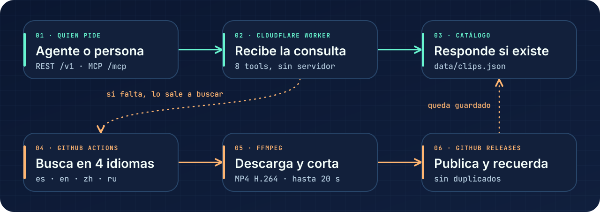
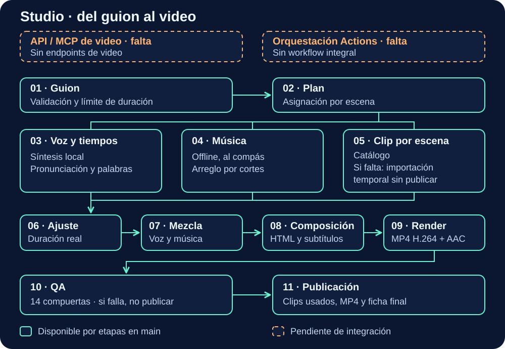

<p align="center">
  
</p>

<p align="center">
  
</p>

<p align="center">
  <a href="https://github.com/riquelmechile/clipoteca-comunitaria/releases/latest"></a>
  <a href="https://github.com/riquelmechile/clipoteca-comunitaria/actions/workflows/ci.yml"></a>
  
  
  <a href="LICENSE"></a>
</p>

## Una biblioteca de escenas que se llena sola

Un agente de IA que arma un video necesita «lluvia, vertical, 8 segundos». Hoy cada agente la busca, la descarga y la corta desde cero, una y otra vez.

**Clipoteca** guarda esa escena la primera vez y la entrega al instante la siguiente. Si no la tiene, la sale a buscar en fuentes públicas en **español, inglés, chino y ruso**, la corta a un máximo de 20 segundos y la deja publicada para todos. Sin frontend, sin cuentas y sin servidor propio: una API REST y un servidor MCP.

> **Estado al 22 de noviembre de 2026:** servicio en producción, **13 fuentes** con búsqueda y descarga comprobadas desde GitHub Actions. El detalle medido, con sus límites, está en [docs/ESTADO.md](docs/ESTADO.md).

## Úsala ahora

No necesitas clave para buscar ni para descargar.

**Desde un agente (MCP remoto, Streamable HTTP):**

```json
{
  "mcpServers": {
    "clipoteca": {
      "url": "https://clipoteca-worker.clipoteca.workers.dev/mcp"
    }
  }
}
```

**Desde cualquier programa (REST):**

```bash
curl -sS 'https://clipoteca-worker.clipoteca.workers.dev/v1/clips?q=lluvia&aspect_ratio=9%3A16'
```

La respuesta trae título y descripción en español e inglés, duración, resolución, proporción, la fuente original y la URL del MP4 en GitHub Releases.

| Tool MCP | Para qué sirve |
|---|---|
| `search_clips` | Buscar en el catálogo por concepto, proporción, duración, fuente o idioma |
| `resolve_script` | Entregar un guion de hasta 50 escenas y recibir un clip por escena |
| `get_clip` | Leer la ficha completa de un clip |
| `get_storyboard` | Ver fotogramas del clip antes de descargarlo |
| `download_clip` | Obtener la URL del MP4 |
| `search_and_import` | Pedir que se busque material nuevo (requiere credencial) |
| `get_job_status` | Seguir una búsqueda en curso |
| `list_sources` | Ver el estado de cada fuente |

Los mismos datos están en REST bajo `/v1`: `clips`, `clips/{id}`, `clips/{id}/storyboard`, `clips/{id}/download`, `search`, `script`, `jobs/{request_id}`, `sources`, `import`, `contributions` y `health`. Contrato completo en [docs/openapi.yaml](docs/openapi.yaml) y [docs/mcp-tools.md](docs/mcp-tools.md).

## Cómo funciona

<p align="center">
  
</p>

- **Si el clip existe**, responde el catálogo (`data/clips.json`) y no se gasta nada más.
- **Si falta** y la consulta lo pide (`import_if_missing`, con cuota, o `/v1/import` con credencial), el Worker despacha una ingesta en GitHub Actions: traduce la consulta, busca en paralelo en todas las fuentes disponibles, descarga, elige la mejor escena y la normaliza con FFmpeg a MP4 H.264 respetando 9:16, 16:9 o 1:1.
- **Lo publicado se queda**: el archivo va a GitHub Releases y su ficha al catálogo, con deduplicación por contenido. La siguiente consulta ya lo encuentra.
- **Dónde corre**: el motor en GitHub Actions, la API y el MCP en un Cloudflare Worker, los datos en este repositorio. No depende de ningún servidor personal.

Cuando el traductor falla en un idioma, la búsqueda sigue con los idiomas que sí resultaron y deja un aviso; nunca se inventa una traducción.

## En construcción: de escenas a videos (v3)

La versión del repositorio es **2.0.6**; la API REST y el MCP públicos siguen siendo la biblioteca v2.
El motor de video en `pipeline/clipoteca/studio/` ya acepta un guion en español de 3 a 12 escenas, hasta 60 segundos, en 9:16, 16:9 o 1:1.
Planifica las escenas, sintetiza voz local con control de pronunciación, obtiene tiempos por palabra y genera música sin red.
Selecciona un clip del catálogo por escena o importa material temporal sin publicarlo.
Ajusta los clips, mezcla el audio y compone títulos y subtítulos palabra a palabra; renderiza MP4 y lo somete a 14 compuertas de calidad.
El módulo de publicación puede guardar los clips usados, el video y su ficha tras aprobar QA. Un workflow manual encadena todas las etapas en GitHub Actions; todavía no está validado con corridas reales ni hay un servicio que entregue videos.

<p align="center">
  
</p>

> **Qué funciona hoy**
> - Las etapas del motor, ejecutadas por separado desde la línea de comandos; publicación incluida, con simulación sin red.
> - CI con pruebas del motor y ejecuciones reales de música, render de tres escenas y layout.
> - Un workflow manual, [`render.yml`](docs/M32_RENDER.md), que reparte voz, música y un trabajo por escena en paralelo, arma el video y corre QA. Por defecto es un ensayo: no publica nada.
>
> **Qué falta**
> - Validar ese workflow con corridas reales: hasta ahora solo se comprobó fuera de Actions el tramo que arma, renderiza y revisa el video.
> - Todavía no existen los endpoints `/v1/videos` ni las tools MCP `render_video` y `get_video_status`.
> - Validar la importación de material nuevo de punta a punta dentro del flujo de video en Actions.
> - Incrustar una tipografía propia, ajustar la franja del título a la posición del sujeto y publicar la versión 3.0.0.

Consulta la [guía del motor](docs/STUDIO.md) y el [roadmap v3](docs/ROADMAP_V3.md).

## Fuentes: lo medido, no lo prometido

Medición del 22 de noviembre de 2026 desde GitHub Actions sobre `main`, con las pruebas en vivo [45082009984](https://github.com/riquelmechile/clipoteca-comunitaria/actions/runs/45082009984) (búsqueda en cuatro idiomas) y [45082001946](https://github.com/riquelmechile/clipoteca-comunitaria/actions/runs/45082001946) (descarga real de un video por fuente).

| Resultado medido | Fuentes |
|---|---|
| **Buscan y descargan** (13) | Pexels, Pixabay, Wikimedia Commons, Internet Archive, NASA, Library of Congress, PeerTube, Odysee, RuTube, OK.ru, VK Video, Dzen, Bilibili |
| **Esperan una API key** (8) | Coverr, Europeana, NARA, DPLA, Smithsonian, YouTube, Instagram, Snapchat |
| **Exigen sesión iniciada** (2) | TikTok y Douyin, apagadas por defecto |

Que una fuente funcione hoy no garantiza que funcione mañana: los proveedores cambian, limitan por IP y bloquean centros de datos. Límites vistos en esta medición: Library of Congress limitó las consultas en chino y ruso; NASA y PeerTube solo devolvieron resultados en inglés; YouTube, DPLA, Smithsonian, Instagram y Snapchat serían solo de búsqueda aun con clave. La tabla por fuente e idioma está en [docs/ESTADO.md](docs/ESTADO.md).

## Aporta una escena

[Abre el formulario «Aportar escena»](https://github.com/riquelmechile/clipoteca-comunitaria/issues/new/choose) con una URL HTTPS directa a un MP4, WebM u OGV y sus datos de procedencia. El Issue se procesa solo: valida, corta, deduplica y publica, sin permisos de escritura ni revisión manual. Si algo falla, el motivo queda comentado en el Issue y editarlo reintenta. Más en la [guía de colaboración](CONTRIBUTING.md).

## Documentación

| Quiero… | Documento |
|---|---|
| Saber qué funciona hoy y qué no | [Estado actual](docs/ESTADO.md) |
| Integrar la API o el MCP | [OpenAPI](docs/openapi.yaml) · [Tools MCP](docs/mcp-tools.md) · [Contratos](docs/CONTRATOS_API_MCP.md) |
| Entender el diseño | [Arquitectura](docs/ARQUITECTURA.md) · [Especificación completa](docs/ESPECIFICACION_COMPLETA.md) |
| Operar o desplegar | [Despliegue](docs/DESPLIEGUE.md) · [Operación v2](docs/OPERACION_V2.md) · [Proveedores](docs/PROVEEDORES.md) |
| Ver cómo se llegó hasta aquí | [Roadmap v1](docs/ROADMAP.md) · [Roadmap v2](docs/ROADMAP_V2.md) · [Roadmap v3](docs/ROADMAP_V3.md) · [Historial de cambios](CHANGELOG.md) |
| Ejecutar el motor de video en construcción | [Studio](docs/STUDIO.md) · [Guion de ejemplo](docs/ejemplos/guion-minimo.json) |
| Ver todo | [Índice de documentación](docs/README.md) |

## Qué no es

- Todavía no es un servicio que entregue videos por API.
- No es un buscador de videos completos: solo escenas de hasta 20 segundos.
- No define todavía reglas de licencias ni de uso de los clips: conserva la procedencia factual de cada uno (fuente, URL y autor cuando existe) y deja esa decisión a quien lo usa. La licencia MIT cubre el código, no los clips de terceros.
- No promete disponibilidad de las fuentes externas.

## Klipi


**Klipi** es el explorador de fotogramas de la biblioteca: un fotograma con perforaciones de película, un botón de reproducción y una lupa. La paleta, la mascota y todos los SVG del repositorio son originales y están descritos en [docs/IDENTIDAD.md](docs/IDENTIDAD.md).

## Licencia

Código bajo [licencia MIT](LICENSE). Las ideas y mejoras son bienvenidas en [CONTRIBUTING.md](CONTRIBUTING.md).

---

<p align="center">
  <strong>Una escena encontrada. Una biblioteca que crece.</strong><br/><br/>
  
</p>
