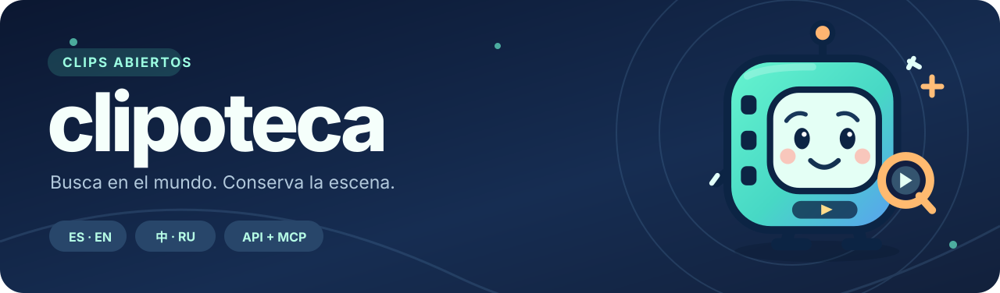

<div align="center">



<br/>

**Una biblioteca comunitaria de clips, pensada para personas y agentes de IA.**

**Multiling&#xFC;e &#xB7; Abierta &#xB7; Reutilizable &#xB7; Hasta 20 segundos**

[&#x1F4CB; Roadmap](docs/ROADMAP.md) &#xB7; [&#x1F680; Roadmap v2](docs/ROADMAP_V2.md) &#xB7; [&#x1F9ED; Arquitectura](docs/ARQUITECTURA.md) &#xB7; [&#x1F310; Fuentes e idiomas](docs/FUENTES_IDIOMAS.md) &#xB7; [&#x1F3A8; Identidad](docs/IDENTIDAD.md) &#xB7; [&#x1F91D; Colaborar](CONTRIBUTING.md)

</div>

---

> **Estado v2: 2.0.0 en preparacion, M24 pendiente de evidencia live.** La version del codigo y sus contratos estan sincronizados, pero el Worker desplegado se verifico previamente con v1.0.0; este cambio NO despliega 2.0.0, ni crea tag o release. El smoke por proveedor/idioma, la matriz live y la demo E2E de cinco escenas siguen pendientes. **Evidencia historica v1:** Servicio: [clipoteca-worker.clipoteca.workers.dev](https://clipoteca-worker.clipoteca.workers.dev), con API REST `/v1/*` y MCP Streamable HTTP `/mcp`. Hay **8 clips reales publicados** en el cat&#xE1;logo, con material de Pexels, PeerTube y un aporte comunitario ([Issue #26](https://github.com/riquelmechile/clipoteca-comunitaria/issues/26), `clip-000008`). La ingesta admite consultas ES/EN/ZH/RU. Los proveedores que requieren credenciales ausentes se clasifican `AUTH_REQUIRED`; Bilibili bloquea solicitudes desde determinadas IP de centros de datos. La verificaci&#xF3;n real no equivale a disponibilidad universal de las 15 fuentes ni a costos facturados conocidos. Ver [evidencias v1](docs/INFORME_V1.md) y [operaci&#xF3;n M10](docs/OPERACION_M10.md).

## Uso

Buscar clips p&#xFA;blicos desde la API REST (el filtro `aspect_ratio` usa URL encoding):

```bash
curl --fail-with-body -sS 'https://clipoteca-worker.clipoteca.workers.dev/v1/clips?q=lluvia&aspect_ratio=9%3A16'
```

Conectar un cliente MCP compatible con HTTP remoto usando la direcci&#xF3;n `https://clipoteca-worker.clipoteca.workers.dev/mcp`. Ejemplo de configuraci&#xF3;n para un cliente que acepta `mcpServers`:

```json
{
  "mcpServers": {
    "clipoteca": {
      "url": "https://clipoteca-worker.clipoteca.workers.dev/mcp"
    }
  }
}
```

Para aportar una escena, [abre el formulario &#xAB;Aportar escena&#xBB;](https://github.com/riquelmechile/clipoteca-comunitaria/issues/new/choose) en GitHub Issues, indica una URL HTTPS directa a MP4/WebM/OGV y los datos de procedencia. El Issue se procesa autom&#xE1;ticamente; no requiere permisos de escritura del repositorio. Ver [gu&#xED;a de colaboraci&#xF3;n](CONTRIBUTING.md).


## La idea

Buscar una escena no deber&#xED;a significar encontrarla y descargarla de cero una y otra vez.

**Clipoteca** est&#xE1; dise&#xF1;ada para que un agente solicite, por ejemplo, **&#xAB;lluvia, vertical 9:16&#xBB;**. El sistema consultar&#xE1; su cat&#xE1;logo y, cuando haga falta, buscar&#xE1; en fuentes externas usando cuatro idiomas, procesar&#xE1; clips nuevos de hasta 20 segundos y conservar&#xE1; sus archivos en **GitHub Releases** para futuras consultas.

### Cuatro idiomas, una biblioteca

| Espa&#xF1;ol | English | &#x4E2D;&#x6587; | &#x420;&#x443;&#x441;&#x441;&#x43A;&#x438;&#x439; |
|---|---|---|---|
| **lluvia** | **rain** | **&#x4E0B;&#x96E8;** | **&#x434;&#x43E;&#x436;&#x434;&#x44C;** |
| Metadatos ES | Metadata EN | B&#xFA;squeda ZH | B&#xFA;squeda RU |

Las b&#xFA;squedas externas en **espa&#xF1;ol, ingl&#xE9;s, chino y ruso son requisitos obligatorios**, no caracter&#xED;sticas opcionales. Todos los clips se catalogar&#xE1;n con t&#xED;tulos, descripciones y etiquetas en **espa&#xF1;ol e ingl&#xE9;s**, conservando el idioma y fuente de origen.

## Componentes de v1

| Componente | Responsabilidad |
|---|---|
| **API REST + MCP** | Buscar clips por concepto, duraci&#xF3;n, proporci&#xF3;n, orientaci&#xF3;n y fuente; obtener sus archivos |
| **Motor multiling&#xFC;e** | Ejecutar b&#xFA;squedas paralelas ES/EN/ZH/RU con l&#xED;mites y fallos aislados |
| **Ingesta autom&#xE1;tica** | Descargar material nuevo accesible, deduplicar, normalizar con FFmpeg y generar miniaturas |
| **Cat&#xE1;logo p&#xFA;blico** | Metadatos ES/EN, 9:16 o 16:9, resoluci&#xF3;n, FPS, duraci&#xF3;n y procedencia |
| **GitHub Releases** | Almacenar los clips procesados y hacerlos recuperables sin buscar dos veces |

**Stack:** Cloudflare Workers + TypeScript (API y MCP), GitHub Actions + Python/FFmpeg (procesamiento), GitHub Releases y cat&#xE1;logo JSON. No se necesita un servidor Oracle ni una web Astro.

## Fuentes del roadmap

**Stock:** Pexels, Pixabay. **Archivos:** Wikimedia Commons, Internet Archive, NASA. **Video:** YouTube, RuTube, PeerTube, Odysee, VK Video, Bilibili. **Redes:** Douyin, TikTok, Instagram Reels y Snapchat.

Cada fuente tendr&#xE1; un adaptador con capacidades y estados verificables. La posibilidad t&#xE9;cnica de descargar archivos var&#xED;a entre plataformas; no se considera integrado un proveedor solo por figurar en esta lista.

[Leer matriz de fuentes e idiomas](docs/FUENTES_IDIOMAS.md)

## Ruta de trabajo

El roadmap tiene **11 hitos, de M0 a M10**: estructura inicial, cat&#xE1;logo y Releases, FFmpeg, motor multiling&#xFC;e obligatorio, grupos de proveedores, API/MCP, publicaci&#xF3;n autom&#xE1;tica, aportes comunitarios y validaci&#xF3;n final.

**[Consultar el roadmap completo con criterios de aceptaci&#xF3;n](docs/ROADMAP.md)**

### Documentaci&#xF3;n t&#xE9;cnica

| Documento | Contenido |
|---|---|
| [Proyecto y alcance](docs/PROYECTO.md) | Requisitos, casos de uso y l&#xED;mites |
| [Arquitectura](docs/ARQUITECTURA.md) | Componentes y ejecuci&#xF3;n sin servidor propio |
| [Fuentes e idiomas](docs/FUENTES_IDIOMAS.md) | Proveedores y cuatro idiomas obligatorios |
| [Contratos REST/MCP](docs/CONTRATOS_API_MCP.md) | Interfaces y metadatos previstos |
| [Roadmap](docs/ROADMAP.md) | Hitos, pruebas y condiciones de cierre |
| [Roadmap v2](docs/ROADMAP_V2.md) | Hitos M11&#x2013;M24 del motor post-1.0 |
| [QA y operaci&#xF3;n](docs/QA_OPERACION.md) | Verificaci&#xF3;n, controles y costos |
| [Especificaci&#xF3;n completa](docs/ESPECIFICACION_COMPLETA.md) | Documento integral original, conservado sin cambios de contenido |
| [Identidad visual](docs/IDENTIDAD.md) | Mascota Klipi, paleta y SVG |

## Conoce a Klipi


**Klipi** es el explorador de fotogramas de la biblioteca: un personaje original que combina el contorno de una pel&#xED;cula, un bot&#xF3;n de reproducci&#xF3;n y una lupa para descubrir escenas.

Los SVG originales del [banner](assets/clipoteca-banner.svg), [logotipo](assets/clipoteca-logo.svg), [isotipo](assets/clipoteca-mark.svg), [mascota](assets/klipi-mascot.svg) y [tarjeta social](assets/clipoteca-social.svg) est&#xE1;n incluidos en este repositorio.

## Colaboraci&#xF3;n y licencia

El proyecto se publica con **[licencia MIT](LICENSE)**, compatible con desarrollar en el futuro funciones de cr&#xE9;ditos, servicios comerciales u otras modalidades de acceso. La implementaci&#xF3;n de cr&#xE9;ditos no forma parte de esta primera fase; los recursos almacenados p&#xFA;blicamente en GitHub no se vuelven privados por incorporar cr&#xE9;ditos a una API.

Puedes [proponer ideas y mejoras](CONTRIBUTING.md). Las pol&#xED;ticas comunitarias para los clips y sus aportes se debatir&#xE1;n posteriormente.

---

<div align="center">

**Una escena encontrada. Una biblioteca que crece.**


</div>
