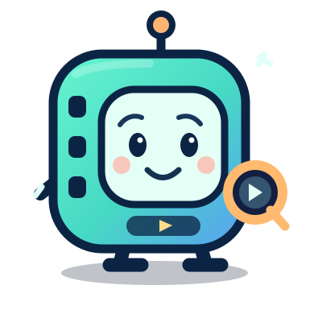

# Identidad visual de Clipoteca

## Concepto

**Clipoteca** reúne y vuelve a encontrar escenas audiovisuales. Su mascota original, **Klipi**, combina un fotograma con perforaciones de película, una cara amistosa y una lupa con un botón de reproducción. Evoca búsqueda, descubrimiento y colaboración sin depender de una plataforma concreta.

## Sistema visual

| Token | Color | Uso |
|---|---|---|
| Noche | `#0B1731` | Fondos, contraste |
| Tinta | `#0C2444` | Contornos, texto oscuro |
| Menta | `#67F5CF` | Elementos principales |
| Agua | `#47D8C5` | Gradientes y acentos |
| Dorado | `#FFB571` | Descubrimiento, punto focal |
| Blanco suave | `#E4FFF5` | Caras, superficies y tipografía |

Tipografía recomendada: **Inter**, con alternativas del sistema `Arial, Helvetica, sans-serif`. Los SVG funcionan sin descargar fuentes.

## Archivos

- [Banner de la portada](../assets/clipoteca-banner.svg) — 1280 × 376
- [Logotipo horizontal](../assets/clipoteca-logo.svg) — 900 × 194
- [Isotipo cuadrado](../assets/clipoteca-mark.svg) — 512 × 512
- [Klipi, mascota vectorial](../assets/klipi-mascot.svg) — 390 × 385
- [Tarjeta social](../assets/clipoteca-social.svg) — 1200 × 630

Los cinco gráficos son SVG originales editables, con `viewBox`, títulos accesibles y sin dependencias externas, scripts o fotografías incrustadas.

### Piezas animadas del README

- [Portada animada](../assets/clipoteca-hero.svg) — 1280 × 400. Aurora lenta en menta, azul y dorado; Klipi flota suavemente.
- [Consola de consultas](../assets/clipoteca-typing.svg) — 1280 × 132. Escribe y borra cuatro consultas reales.
- [Diagrama de funcionamiento](../assets/clipoteca-pipeline.svg) — 1280 × 452. Seis pasos; un punto menta recorre la consulta y uno dorado la ingesta.

Las tres son SVG puro: la animación es SMIL y CSS dentro del archivo, sin JavaScript ni recursos externos, que es lo que GitHub permite al mostrar un SVG como imagen. El texto está convertido a trazados (Inter y JetBrains Mono, ambas con licencia OFL), así que se ve igual en cualquier equipo. Cada pieza usa un solo tipo de movimiento y lo detiene cuando el visitante pide reducir animaciones (`prefers-reduced-motion`). Llevan fondo propio oscuro, igual que el banner, para verse bien en los temas claro y oscuro de GitHub.

## Uso

Mantener márgenes generosos y alto contraste. No estirar los personajes ni alterar sus proporciones. Usar el logotipo sobre un fondo oscuro y evitar pequeños textos cuando el recurso se muestre como avatar.

Estos recursos forman parte del repositorio bajo la licencia del proyecto, salvo indicación posterior. La licencia de software **no determina los derechos de los clips de terceros** que en el futuro se almacenen o distribuyan.
