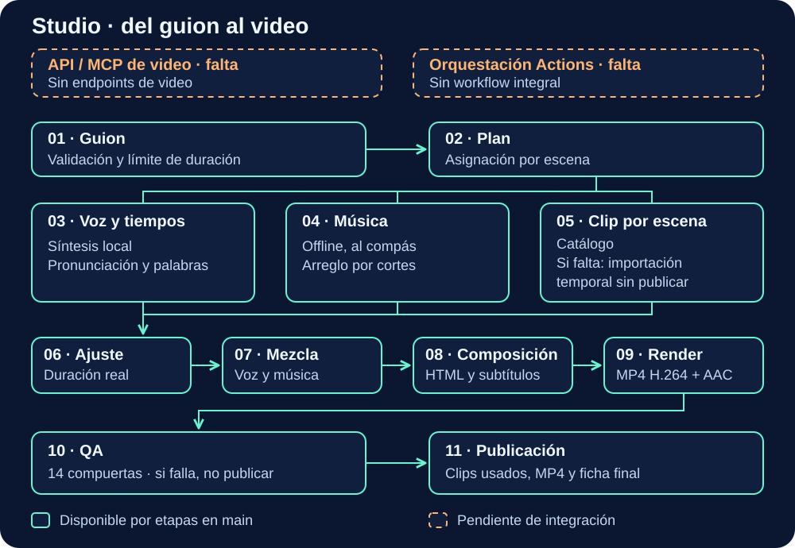
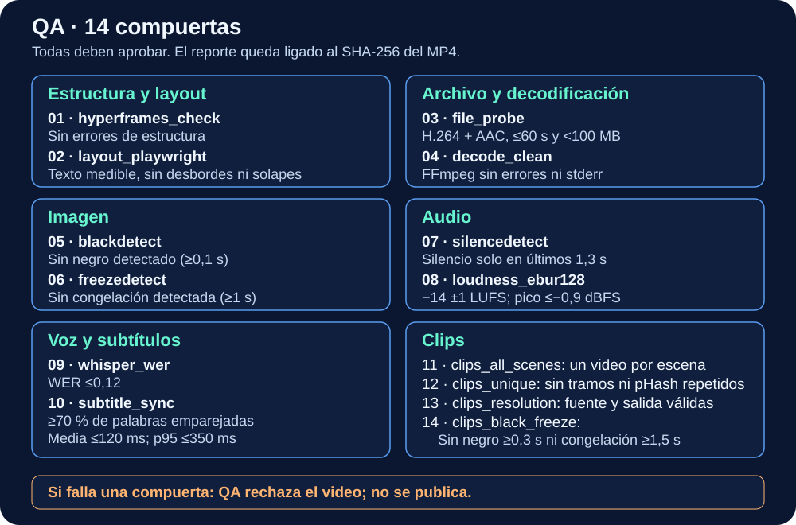

# Studio: motor de video v3

Studio transforma un guion español en MP4 con voz, música y clips reales.
No contiene un LLM. La versión del repositorio es 3.0.0; la API y el
workflow de entrega están desplegados. Ver [M32_RENDER.md](M32_RENDER.md).



## Requisitos

Desde la raíz de un checkout, usa Python 3.13 o posterior (el CI usa 3.13),
uv, FFmpeg y FFprobe, Node 22 (incluye npm/npx, como en CI) y Chromium
de Playwright. Instala el extra `studio`; `dev` añade las pruebas.
El extra `translate` es necesario al importar material externo con Argos
y sus modelos fijados (ver [M28 importación](M28_IMPORT.md)).
No se necesitan los extras `embeddings` ni `tiktok` para el recorrido
desde el catálogo.

```bash
uv sync --frozen --extra studio --extra dev
uv run --no-sync playwright install --with-deps chromium
# Para importar material nuevo, conserva también ambos extras:
uv sync --frozen --extra studio --extra dev --extra translate
```

El extra studio declara las siguientes dependencias en
[pyproject.toml](../pyproject.toml):

| Componente | Versión declarada |
|---|---|
| sherpa-onnx y sherpa-onnx-core | 1.13.8 |
| faster-whisper / ctranslate2 | 1.2.1 / 4.9.0 |
| onnxruntime | 1.31.1 |
| scipy, soundfile | Sin pin directo; resolver con uv.lock |
| phonemizer-fork / espeakng-loader / num2words | 3.3.2 / 0.2.4 / 0.5.14 |
| playwright / tokenizers | 1.65.2 / 0.23.3 |
| opencv-python-headless / rapidocr-onnxruntime | 5.0.0.93 / 1.2.3 |

[models.json](../pipeline/clipoteca/studio/models.json) es la fuente de
nombres, tamaños, SHA-256 y URLs de los modelos:

| Modelo | Origen y fijación |
|---|---|
| Supertonic 3 int8 | Release models-v1 del repositorio, con origen alternativo tts-models de sherpa-onnx; archivo verificado |
| wav2vec2 fonético ONNX int8 y vocabulario | Release models-v1, tamaño y SHA-256 |
| CLIP ViT-B/32 ONNX int8 y tokenizer | Release models-v1; origen Xenova/clip-vit-base-patch32, revisión y hashes fijados |
| Whisper small int8 | Hugging Face, Systran/faster-whisper-small, revisión fijada |

Los modelos verificados se guardan por defecto en `.cache/studio-models`;
se puede elegir otro directorio con `CLIPOTECA_STUDIO_MODELS`.
La descarga inicial de modelos y de los clips del catálogo necesita red.

No todas las etapas descargan su modelo. La voz baja sola Supertonic 3
(unos 129 MB) y el modelo fonético (unos 357 MB), y Whisper se descarga
al usarlo. El modelo CLIP (unos 156 MB entre sus tres archivos) **no se
descarga solo**: `clipscene` espera encontrarlo ya en la carpeta de
modelos. Este comando lo baja del Release `models-v1` y verifica sus
SHA-256:

```bash
uv run --no-sync python -c "from clipoteca.studio import models; models.ensure_model('clip-vit-b32')"
```

Sin ese paso, `clipscene` no puede evaluar ningún candidato y la escena
termina sin clip aunque el catálogo tenga material.
Tone.js 15.1.22 está incluido en el repositorio; su render musical es offline.
HyperFrames 0.9.36 se ejecuta vía npx; GSAP 3.15.1 se descarga de npm,
se verifica por hash y no está incluido en el repo.

## Guion

El [esquema M25](../schemas/video.schema.json) valida claves desconocidas,
IDs y tipos. Ejemplo listo para el parser:
[guion-minimo.json](ejemplos/guion-minimo.json), tres escenas sobre el agua.
El número 3 aparece en el texto: la voz lo pronuncia en palabras y el
subtítulo conserva el texto escrito.

| Campo | Contrato |
|---|---|
| title, aspect | Título de hasta 120 caracteres; 9:16, 16:9 o 1:1 |
| language | es (por defecto) |
| music | mood upbeat, chill o epic; bpm 60–180 (120 por defecto) |
| voice | M1–M5 o F1–F5; speed 0,8–1,5; lexicon opcional; F1 y 1,2 por defecto |
| scenes | 3–12; ID único; type intro, fact u outro; al menos una fact |
| Campos de escena | id, type, title, say, query.es, query.en, prompt; opcionales sub, caption, avoid, query.related |

`query.related` acepta listas opcionales `es` y `en` de hasta ocho terminos por idioma
(por ejemplo, `{"es":["Castro","Ancud"],"en":["Chiloe churches"]}`). Deben ser
conceptos o lugares vinculados realmente a la escena, no palabras de relleno.

El plan rechaza estimaciones superiores a 60 segundos; la línea de tiempo
rechaza duraciones reales mayores y QA comprueba el MP4. La entrada del
motor no es el mismo contrato de `resolve_script` de v2.

## Etapas y comandos

Los comandos de la tabla se ejecutan desde la raíz, dentro del entorno
instalado con uv (anteponer `uv run --no-sync`). Para los dos módulos
sin CLI se indica la función que consume el plan. `--out` es directorio
salvo donde dice archivo.

| Módulo | Entrada → salida | Comando o función |
|---|---|---|
| script | JSON → guion validado e ID determinista | `parse_video_script`, `script_id`; sin main |
| plan | guion y catálogo → plan.json, scenes/ID/job.json y assignment.json | `python -m clipoteca.studio.plan --script build/video/guion.json --catalog data/clips.json --out build/video` |
| voice | guion → voice.json y audio/ID.wav | `python -m clipoteca.studio.voice render --script build/video/guion.json --out build/video/voice` |
| timeline | guion, WAV y ASR → timeline.json (archivo) | `python -m clipoteca.studio.timeline --script build/video/guion.json --voice build/video/voice --out build/video/timeline.json` |
| music | plan → head.wav, bed.wav, hit.wav, music.json | `python -m clipoteca.studio.music render --plan build/video/plan.json --out build/video/music` |
| music | música y timeline → music.wav (archivo) | `python -m clipoteca.studio.music track --music build/video/music --timeline build/video/timeline.json --out build/video/music.wav` |
| library | catálogo y consultas → asignaciones y respaldos | `load_catalog`, `assign_scenes` a través de plan; sin main |
| clipscene | job y assignment → clip.mp4 y result.json | `python -m clipoteca.studio.clipscene --job build/video/scenes/intro/job.json --assignment build/video/scenes/intro/assignment.json --out build/video/scenes/intro` |
| importer | job y catálogo → manifiesto y archivos temporales | `python -m clipoteca.studio.importer scene --job build/video/scenes/intro/job.json --catalog data/clips.json --out build/video/scenes/intro/import` |
| fit | timeline y clips/ID.mp4 → fit/ID.mp4 y fit.json | `python -m clipoteca.studio.fit --timeline build/video/timeline.json --clips build/video/clips --out build/video/fit` |
| mix | timeline, voz y música → mix.wav (archivo), mix.json | `python -m clipoteca.studio.mix --timeline build/video/timeline.json --voice build/video/voice --music build/video/music.wav --out build/video/mix.wav` |
| compose | guion, timeline, clips ajustados, mezcla → hf/, chunks.json | `python -m clipoteca.studio.compose build --script build/video/guion.json --timeline build/video/timeline.json --clips build/video/fit --mix build/video/mix.wav --out build/video` |
| compose | hf/ → video.mp4 (archivo), render.json | `python -m clipoteca.studio.compose render --hf build/video/hf --out build/video/video.mp4` |
| qa | árbol del video → qa_report.json | `python -m clipoteca.studio.qa --work build/video` |
| index | Todos los clips importados → index.json y catálogo (simulación sin red opcional) | `python -m clipoteca.studio.index --work build/video --dry-run build/indexado` |
| delivery | MP4, QA, escenas e índice → entrega.json | `python -m clipoteca.studio.delivery --work build/video --catalog data/clips.json` |
| selection | Selección fuerte o comparación de catálogo/importados | `python -m clipoteca.studio.selection --scene build/video/scenes/intro --phase catalog` |

## Recorrido manual

Este orden usa el guion de ejemplo. Ejecuta desde un checkout con los
requisitos instalados y un directorio de trabajo nuevo. No garantiza que
haya clips adecuados: si una escena falla, no continúes con el montaje.
Para importar, configura los modelos de traducción y credenciales de
las fuentes que uses, como indica [M28 importación](M28_IMPORT.md).
El ejemplo no escribe en GitHub.

```bash
set -eu
mkdir -p build/video/clips
cp docs/ejemplos/guion-minimo.json build/video/guion.json
uv run --no-sync python -m clipoteca.studio.plan --script build/video/guion.json --catalog data/clips.json --out build/video
uv run --no-sync python -m clipoteca.studio.voice render --script build/video/guion.json --out build/video/voice
uv run --no-sync python -m clipoteca.studio.timeline --script build/video/guion.json --voice build/video/voice --out build/video/timeline.json
uv run --no-sync python -m clipoteca.studio.music render --plan build/video/plan.json --out build/video/music
uv run --no-sync python -m clipoteca.studio.music track --music build/video/music --timeline build/video/timeline.json --out build/video/music.wav
# El modelo que evalúa los clips no se descarga solo:
uv run --no-sync python -c "from clipoteca.studio import models; models.ensure_model('clip-vit-b32')"
for id in intro nubes lluvia; do
  scene="build/video/scenes/$id"
  code=0
  uv run --no-sync python -m clipoteca.studio.selection --scene "$scene" --phase catalog || code=$?
  [ "$code" -eq 0 ] || [ "$code" -eq 3 ] || exit "$code"
  strong=$(python3 -c 'import json,sys; print(json.load(open(sys.argv[1])).get("catalog_strong",False))' "$scene/result.json")
  if [ "$strong" != True ]; then
    code=0
    uv run --no-sync python -m clipoteca.studio.importer scene --job "$scene/job.json" --catalog data/clips.json --out "$scene/import" --max-results 8 --spread-queries --timeout 600 || code=$?
    [ "$code" -eq 0 ] || [ "$code" -eq 3 ] || exit "$code"
    code=0
    uv run --no-sync python -m clipoteca.studio.selection --scene "$scene" --phase finish || code=$?
    [ "$code" -eq 0 ] || [ "$code" -eq 3 ] || exit "$code"
    retry=$(python3 -c 'import json,sys; print(json.load(open(sys.argv[1])).get("needs_retry",False))' "$scene/result.json")
    if [ "$retry" = True ]; then
      code=0
      uv run --no-sync python -m clipoteca.studio.importer scene --job "$scene/job.json" --catalog data/clips.json --out "$scene/import-retry" --max-results 2 --spread-queries --simple --timeout 180 || code=$?
      [ "$code" -eq 0 ] || [ "$code" -eq 3 ] || exit "$code"
      uv run --no-sync python -m clipoteca.studio.selection --scene "$scene" --phase finish
    fi
  fi
  cp "$scene/clip.mp4" "build/video/clips/$id.mp4"
done
uv run --no-sync python -m clipoteca.studio.index --work build/video --dry-run build/indexado
uv run --no-sync python -m clipoteca.studio.fit --timeline build/video/timeline.json --clips build/video/clips --out build/video/fit
uv run --no-sync python -m clipoteca.studio.mix --timeline build/video/timeline.json --voice build/video/voice --music build/video/music.wav --out build/video/mix.wav
uv run --no-sync python -m clipoteca.studio.compose build --script build/video/guion.json --timeline build/video/timeline.json --clips build/video/fit --mix build/video/mix.wav --out build/video
uv run --no-sync python -m clipoteca.studio.compose render --hf build/video/hf --out build/video/video.mp4
qa_code=0
uv run --no-sync python -m clipoteca.studio.qa --work build/video || qa_code=$?
printf '{}' > build/video/timings.json
uv run --no-sync python -m clipoteca.studio.delivery --work build/video --catalog data/clips.json
[ "$qa_code" -eq 0 ]
```

La voz, la música y el material de escenas pueden prepararse por separado;
la mezcla necesita la línea de tiempo real. Si fit indica que un clip
es demasiado corto o QA detecta duplicados, selecciona otro candidato
y repite las etapas dependientes. En este recorrido manual no hay
re-despacho automático; el workflow sí repite la escena de menor puntaje
cuando dos eligen el mismo clip.
El código 3 de clip-scene indica escena sin resultado válido, no éxito.

El indexado local se ejecuta antes de montaje/QA: deja el catálogo y
assets bajo build/indexado; no escribe en GitHub. En una corrida real
el job index independiente incorpora todos los clips válidos importados,
con reintentos por conflicto y sin bloquear assemble.
El reporte entrega.json liga el MP4 a QA e identifica los clips usados
y los indexados conocidos; indexed-clips complementa el estado cuando acaba
el índice remoto. El MP4 se entrega si QA aprueba; no se publica
el video en Releases ni en el catálogo de clips. La corrida de Actions es pública. El ejemplo manual no mide tiempos por etapa
(el JSON vacío solo indica que no se midieron).
Consulta [M32](M32_RENDER.md).

## QA: las 14 compuertas



| Compuerta | Criterio |
|---|---|
| hyperframes_check | Check passed, código cero y cero errores |
| layout_playwright | Texto medible, sin desbordes, solapes ni fuera de zona segura |
| file_probe | H.264 y AAC, tamaño de cuadro correcto, diferencia de duración menor a 0,35 s, hasta 60 s y menos de 100 MB |
| decode_clean | FFmpeg termina con código cero y stderr vacío |
| blackdetect | Sin black_start con d=0,1 |
| freezedetect | Sin freeze_start con d=1 |
| silencedetect | Silencio solo en los últimos 1,3 s |
| loudness_ebur128 | −14 ±1 LUFS; pico real ≤ −0,9 dBFS |
| whisper_wer | WER normalizado ≤ 0,12 |
| subtitle_sync | ≥70 % de palabras emparejadas; media ≤120 ms y p95 ≤350 ms |
| clips_all_scenes | Una escena ok por clip, un video por escena, ninguna imagen fija |
| clips_unique | pHash válido, sin conflictos de tramo ni distancia pHash ≤6 |
| clips_resolution | Lado corto fuente ≥720 o misma orientación con lado largo ≥0,53 del destino; salida exacta |
| clips_black_freeze | Sin negro ≥0,3 s ni congelación ≥1,5 s |

El [contrato M31](M31_QA.md) explica los umbrales y el reporte. Si una
compuerta falla, pass=false; el reporte incluye el SHA-256 y tamaño
del MP4, para que no pueda servir de aprobación a otro archivo.
QA no aplica criterios de licencias ni créditos.

## Qué prueba CI

El [job studio](../.github/workflows/ci.yml) instala Python 3.13, Node 22,
FFmpeg, los extras dev y studio y Chromium. Ejecuta las suites de guion,
modelos, voz, timeline, música, plan, ventanas, biblioteca, clip-scene,
encuadre, checks, importación, ajuste, mezcla, composición, QA,
normalización de texto e indexado; el conjunto no descarga modelos.
Además, exige tres pasos reales que no se pueden omitir:

- Render musical en Chromium headless, con head.wav, bed.wav, hit.wav no vacíos.
- Render real HyperFrames de tres escenas con el flag CLIPOTECA_M30_REAL_RENDER.
- Layout real en Chromium con el flag CLIPOTECA_M31_REAL_LAYOUT, detección de texto fuera de zona y solapado.

El workflow manual [voice-sample](../.github/workflows/voice-sample.yml)
genera muestras para las diez voces. Su existencia no demuestra que la
tabla completa de resultados ya esté publicada. Las mediciones disponibles
y su contexto están en [ESTADO.md](ESTADO.md).

## Límites conocidos y pendiente

- La duración final supera la pedida y una escena con poco material puede terminar con un clip de respaldo; ver [ESTADO.md](ESTADO.md).
- QA no mide si el clip corresponde al tema de la escena: un video puede aprobar las 14 compuertas con una toma poco pertinente.
- No hay tipografía propia incrustada ni colocación de la franja del título según el sujeto.
- La mejor toma de voz puede quedar bajo umbral; QA final no lo convierte en éxito.
- Falta la tabla completa de voz, las mediciones por mood y las de ajuste y mezcla.
- M28 solo conserva el hash original del MP4: la integridad de previews se acredita al publicar. Un storyboard huérfano tras rollback puede producir una colisión de nombre; M32 lo declara pendiente.
- No hay reglas de licencias o créditos para publicación; se conserva la procedencia factual.

## Documentos por hito

- M25: [roadmap](ROADMAP_V3.md) y [esquema](../schemas/video.schema.json).
- M26: [voz y tiempos](M26_VOZ.md).
- M27: [música](M27_MUSICA.md).
- M28: [clip-scene](M28_CLIP_SCENE.md) e [importación](M28_IMPORT.md).
- M29: [ajuste y mezcla](M29_AJUSTE_MEZCLA.md).
- M30: [composición y render](M30_COMPOSICION.md).
- M31: [QA](M31_QA.md).
- M32: [indexado y entrega](M32_PUBLICACION.md), [workflow](M32_RENDER.md).


## Duración prevista y calidad del render

La estimación histórica de voz (`estimate_durations`, escenas y total)
conserva el contrato de segundos de habla y la expansión de números y
léxico. Con `include_render=True` agrega `render_total`; `plan.total_est`
usa la misma cuantización que el timeline de WAV: 0,6 s de margen por
escena, 1,2 s para el outro, mínimos de cuatro pulsos o 3,5 s y redondeo
al siguiente pulso completo. No se cambió el ritmo de habla de 0,065 s
por carácter dividido por velocidad: falta la duración WAV por línea
para calibrar esa parte.

En la corrida real 45322952524 (Chile, de norte a sur, ocho escenas, voz
1.1), la estimación de habla fue 42,3 s y el render 49,8 s: 7,5 s de
diferencia. El nuevo cálculo separa explícitamente voz de duración
del montaje. Es una corrección metodológica, no una medición de error
típico ni una validación posterior en producción.


### Busqueda relacionada (v3)

- El motor considera hasta ocho terminos distintos por escena, primero los del guion,
  despues Wikidata (busqueda indexada de declaraciones, sin SPARQL; desambiguacion por coordenadas/clase geografica, pais y
  notoriedad; hasta tres raices relacionadas; hijos por ubicacion/partes) y Commons
  (subcategorias de lugares, filtrando categorias meta y eventos fechados).
  Las consultas fallidas se omiten. Para nombres ambiguos se consulta el termino
  junto al lugar padre (por ejemplo, Castro Chiloe), sin modificar tags ni
  rebajar el gate visual. `related_queries` registra la consulta efectiva.
- El plan permanece offline por defecto. En el render real se debe agregar
  `--resolve-related` al comando existente de `clipoteca.studio.plan` de
  `.github/workflows/render.yml` (sin otros cambios). El plan comparte una cache
  por render y un presupuesto de 6 segundos por semilla, cuatro semillas concurrentes y un tope total de 25 segundos. Los plazos de busqueda de clips no cambian.
- La primera ronda conserva el 60% del presupuesto de importacion cuando hay
  relacionados; estos usan el resto con descubrimiento concurrente y escrituras
  locales seriales. El retry usa relacionados, o consultas simplificadas no
  repetidas si no existen. Los limites existentes de 600 y 180 s no cambian.
- El gate usa metadata real, nunca los tags inyectados; CLIP sigue siendo obligatorio.
  `source.found_by_query` y `source.related_to` guardan procedencia solamente.
- `imported.json` registra terminos usados y disponibles con su origen. `entrega.json`
  registra los relacionados de cada escena, `matched_query` y `found_by_query` si
  corresponde. `timings.json` mantiene valores numericos: claves
  `scene.ID.related_terms.ORIGEN.TERMINO` y `scene.ID.matched_query.TERMINO` valen 1.
- El Worker requiere redeploy para anunciar el nuevo campo opcional en MCP.

Prueba de red manual (fuera del CI):

```sh
uv run --no-sync python scripts/smoke_related.py --batch "Chiloé" "Easter Island" "Kyoto temples" "Santiago Chile city"
```

Imprime por consulta las semillas, raices Wikidata (QID y etiqueta), categorias
raiz de Commons, terminos con origen, errores/timeouts por proveedor y latencia del lote. Los tests usan transportes HTTP
simulados y no demuestran los resultados actuales de los servicios externos.

### Robustez de expansion relacionada

El plan escribe `related_diagnostic` en cada job y escena de plan.json, y una
linea JSON por escena en el log. El mismo objeto se conserva en entrega.json
para escenas exitosas o fallidas (incluye raices, terminos por origen, errores
HTTP, timeouts, intentos y tiempos). No se modifica el workflow: ya copia job.json.
La expansion limita Wikimedia a tres peticiones simultaneas por host, respeta
Retry-After (incluyendo maxlag), reintenta una vez y comparte respuestas exitosas
dentro del render. Los seeds vacios por errores tienen una segunda oportunidad
si queda presupuesto; los vacios sin errores no se repiten.

## Aportes de medios (etapa 1)

**Todo lo que subas (archivos, guion y video final) queda público.** La corrida de GitHub Actions es pública.
El MP4 final no forma parte del catálogo de clips. No existe modo privado.

- `register_media_url` / POST `/v1/media`: URL HTTPS directa (sin query, credenciales, IP literal ni redirecciones), kind (video o image), title, author, source y license_note opcional.
- `create_media_upload` / POST `/v1/media/upload`: mismos metadatos sin URL. Devuelve media_id, upload_url, put_url, upload_token y expires_at. Abre upload_url en el navegador o envía PUT a put_url con el archivo binario, Content-Length y Authorization: Bearer seguido de upload_token (no el token de escritura). El enlace vence a los 15 minutos y no permite publicar un segundo archivo.
- `get_media_status` / GET `/v1/media/{id}`: registro público del aporte ya registrado; 404 si aún no existe. Las dos solicitudes POST requieren Bearer de escritura.

Videos MP4, MOV o WebM: máximo 50 MiB y 120 s. Imágenes JPEG, PNG o WebP:
máximo 10 MiB y 24 MP. La validación de cabeceras lee hasta 128 KiB; si
la duración o las dimensiones no se pueden comprobar allí, rechaza el
archivo (por ejemplo, MP4 con moov al final; reexportar con faststart).
No es una decodificación integral. La procedencia es declarada por el
usuario, sin compuerta de copyright. El límite de 12 aportes por video y
la incorporación de medios al guion/render pertenecen a la etapa 2;
solo los videos se indexarán. No se ha modificado el contrato de guion.

El registro de URL usa un Issue público con manifiesto JSON y el token
existente CLIPOTECA_ISSUE_TOKEN (permiso Issues: write de un colaborador
del repositorio). Esto evita depender del nuevo token de Releases.
La subida usa un asset de nombre aleatorio y su manifiesto JSON en la
Release pública mensual uploads-YYYY-MM. No se usa R2, KV ni D1.
El SHA-256 de contenido queda opcional: en esta etapa no se calcula
para no almacenar el archivo completo ni descargar una URL completa.
Si falla el registro después de subir el binario, el asset queda público
sin manifiesto; requiere conciliación manual. No se repite la subida.
La cuota media por IP es 20 aportes y 200 MiB por día UTC (Cache API,
best-effort, sin garantía global entre centros de datos). Las URL se
deduplican por metadatos normalizados y URL; la búsqueda de Issues
tiene consistencia eventual, así que no es una garantía transaccional global.

Para habilitar la subida, crea un token fine-grained de GitHub limitado
al repositorio Clipoteca, con Contents: Read and write. Configura el
secreto del Worker CLIPOTECA_UPLOAD_TOKEN mediante
`wrangler secret put CLIPOTECA_UPLOAD_TOKEN` desde worker/.
No publiques el valor, ni lo pongas en wrangler.toml.
Sin ese secreto la página y las rutas de subida devuelven 503
(uploads_not_configured); el registro por URL sigue funcionando.
